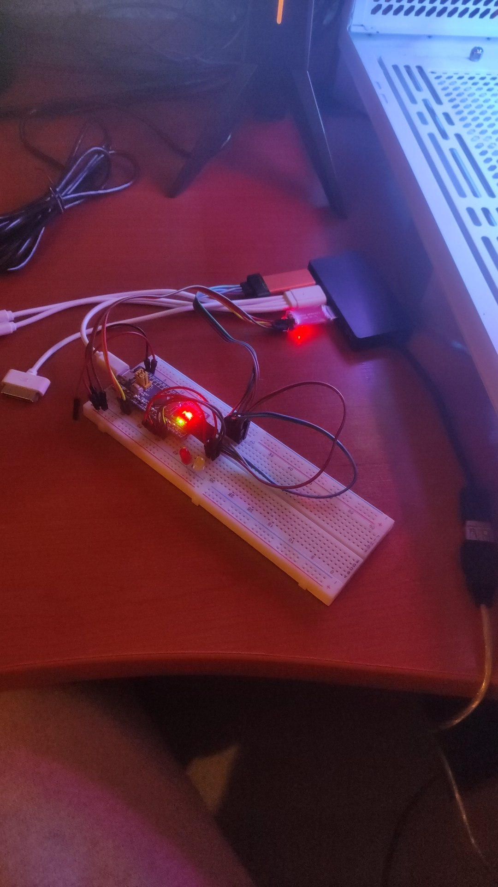

# MikroTik IoT coding test

The test was implemented successfully within couple days, according to given general and functional requirements.

### Setup

Hardware used:
1. STM32F103C8T6 blue pill development kit
2. Breadboard
3. Male headers to connect development kit to the breadboard
4. 2x LED
5. 6x Male-to-Male jumpers
6. 12x Male-to-Female jumpers
7. USB hub
8. CP2102 USB TO TTL
9. USB-A Male to USB-micro male
10. STLINK-v2

A picture below shows how the development environment looks


Software used:
1. arm-none-eabi-gcc
3. OpenOCD
4. make
5. git
6. Clang-format
7. Open-source inspirations for compilation and linking (listed in `docs/sources`)

If you're using Arch Linux, all necessary software may be downloaded with:
```sh
# pacman -S arm-none-eabi-gcc openocd make git clang
```

VSCode was chosen as IDE.

### Compilation

Once necessary software was installed, and hardware connected, the project may be compiled with
```sh
$ make
```

To remove compiled binaries, run
```sh
$ make clean
```

To flash binaries onto the device, run
```sh
$ make flash
```

### Configuration

To change BAUD rate and LED source pin, compilation arguments are provided.<br>
BAUD rate may be one of the following:
- 2400
- 9600
- 19200
- 57600
- 115200
- 230400
- 460800
- 921600
- 2250000

BAUD rate is given with `BAUDRATE` argument:
```bash
$ make BAUDRATE=230400
```

LEDs can also be configured with a total of 4 pin alternatives, 2 for each LED:
- LED 1 can be on either B6 or B7
- LED 2 can be on either B8 or B9

Those are configured in the same way as `BAUDRATE` is, with variables `LED1_PIN` and `LED2_PIN` respectively:
```bash
$ make LED1_PIN=B7
```
```bash
$ make LED1_PIN=B6 LED2_PIN=B9
```

Default values
- `BAUDRATE`, 9600
- `LED1_PIN`, B6
- `LED2_PIN`, B8

### Testing

Baud rates 9600 and 115200 were tested, no issues found.
LEDs were tested with all 4 alternatives, all 4 work.

### Known issues

1. First time setting LEDs they light up only for a brief moment.
2. Program is blocked with setting LEDs, to fix it external interrupts (or timer interrupts) should be used.